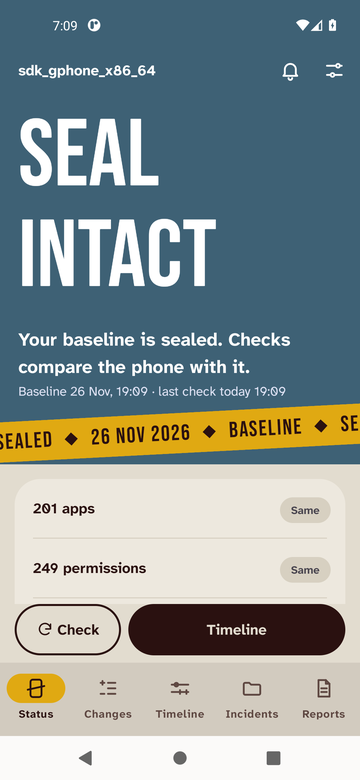
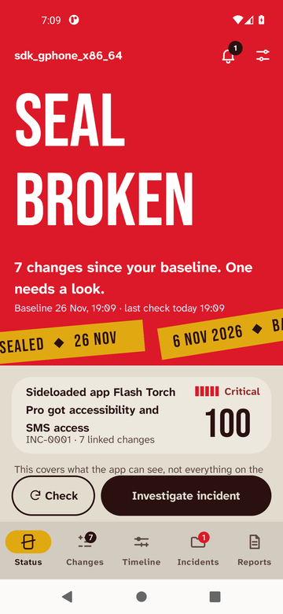
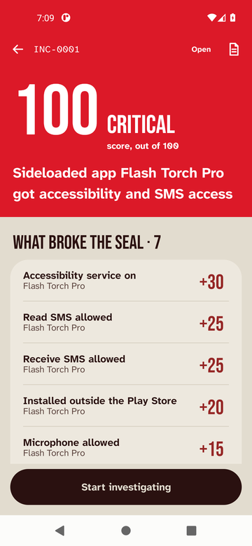
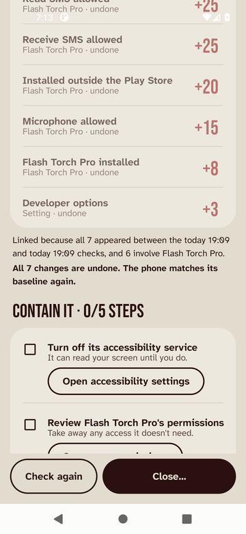

# Can My Phone Be Trusted?

An Android app that answers one question: **what has changed on my phone since it was last considered normal, and should I worry about it?**

It is not an antivirus. It records a *baseline* of the phone while you trust it (every app, the sensitive access each app holds, 8 security settings), then compares the phone with that baseline every 12 hours. Related changes are grouped into scored incidents you can investigate, close, and export as evidence.

Integration Project · EPI Digital School · 2026–2027 · supervised by Mrs Maha Harzallah Triki.

| Seal intact | A sideloaded app breaks it | The incident, scored | After containing it |
|---|---|---|---|
|  |  |  |  |

*Screenshots from an automated run on an Android 11 emulator (`scripts/screens.py`).*

## The five stages

| Stage | What happens | Where in the code |
|---|---|---|
| 1. Baseline | Records apps, versions, signing keys, install source, dangerous permissions, special access and 8 settings | `data/source/DeviceScanner`, `SecurityRepository.sealBaseline` |
| 2. Snapshot & Compare | Scans again and lists every difference | `engine/ChangeDetector` |
| 3. Correlate & Score | Groups changes of the same app and time window into an incident scored 0–100 | `engine/Correlator`, `engine/RiskRules` |
| 4. Investigate | Steps to contain it, notes, "check again", close as Resolved or False positive | `engine/Playbook`, `ui/IncidentActivity` |
| 5. Report | PDF and JSON evidence files, kept on the phone until you share them | `report/ReportWriter` |

## What it detects

- New apps, and whether they came from outside the Play Store (sideloading)
- Apps going back to an older version, or replaced by a build with a different signing key
- New dangerous permissions (SMS, call log, microphone, location, camera, contacts…)
- Special access: accessibility services, device admin, notification access
- Settings: screen lock removed, USB or wireless debugging on, developer options on, encryption off, security patch going backwards, root tools appearing

Example: a sideloaded "torch" app that gets SMS and accessibility access while USB debugging is turned on scores 8 + 20 + 25 + 30 + 8 = **91, Critical**.

## Tech

Java · XML Views · Material 3 · MVVM (UI → ViewModel → Repository → Room / Android APIs) · Room · JobScheduler · PdfDocument · minSdk 26. No third-party libraries beyond AndroidX and Material, and **no internet permission**.

```
ui/          screens (activities, fragments)
viewmodel/   SecurityViewModel: the only door between screens and data
repository/  SecurityRepository: single source of truth
engine/      pure-Java detection, scoring and playbook (unit-tested)
data/        Room database, preferences, DeviceScanner
report/      PDF and JSON writers
work/        background check and notifications
demo-threat/ a harmless fake "spy" app used to test detection
```

## Run it

1. Open the project in Android Studio and run the `app` configuration on an emulator (API 26+).
2. Go through the first-launch pages and record a baseline.
3. To see a real incident, install the harmless fake "Flash Torch Pro" app (it has no screen, so not with Run) and give it what spyware wants:
   ```
   ./gradlew :demo-threat:assembleDebug
   adb install demo-threat/build/outputs/apk/debug/demo-threat-debug.apk
   adb shell pm grant com.example.flashtorch android.permission.READ_SMS
   adb shell settings put secure enabled_accessibility_services com.example.flashtorch/com.example.flashtorch.TorchService
   adb shell settings put secure accessibility_enabled 1
   ```
   Press **Check** in the app: a Critical incident opens.

`python3 scripts/screens.py` does all of this automatically on a running emulator and saves a screenshot of every screen.

Tests: `./gradlew testDebugUnitTest` (detection, scoring and playbook rules).

## Limitations (on purpose, and honest)

- Non-rooted: it only sees what public Android APIs expose. It can't read messages, files or other apps' data, and it doesn't scan for malware.
- Android doesn't log when a permission or setting changes, so those are shown as a window between two checks; only installs and updates have exact times.
- Background checks run when Android allows (about every 12 hours), not at an exact time.
- `QUERY_ALL_PACKAGES` is needed to see every app since Android 11. Google Play restricts it, which is fine for this academic, sideloaded build.
- False positives are expected; every incident can be closed as "False positive".
- Data is local only and disappears if the app is uninstalled (export first).
